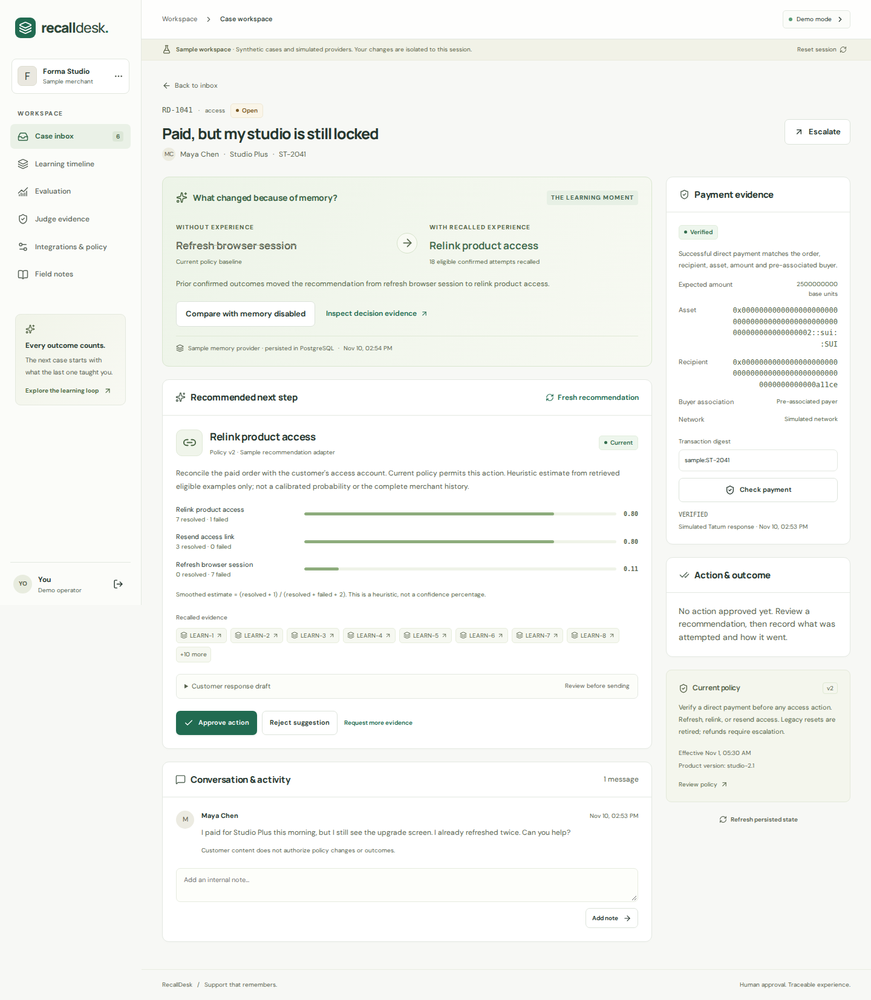

# RecallDesk

**Payment-aware support that remembers what actually helped.**

RecallDesk is a support workspace for merchants selling digital access or services through direct Sui payments. It checks a customer's payment, recalls relevant case experience, applies current merchant policy, and recommends the next eligible remedy. A merchant approves the action and confirms its outcome. Later cases can use that experience, with visible evidence explaining **what changed because of memory**.

Built for **Total Recall — Track 2: Smart Agents for Real Life**. The local case lifecycle, controlled product access, and learning demonstration are implemented and tested. The complete live support journey and public application hosting remain pending.

| Start here | Link |
| --- | --- |
| Source repository | [brishibhatia/recalldesk](https://github.com/brishibhatia/recalldesk) |
| Project article | [Published write-up and walkthrough](https://brishibhatia.github.io/recalldesk/) |
| Recorded demo | [Watch the 2:40 video](https://brishibhatia.github.io/recalldesk/recalldesk-demo.webm) — synthetic cases and simulated providers, with captions |
| Run the application | [Local setup](#run-locally); opens at `http://localhost:3000` after startup |
| Inspect the evidence | [Verification record](docs/verification.md), [evaluation report](artifacts/evaluation/latest.json), [submission checklist](docs/submission-checklist.md) |

**The published site hosts the article and video. There is no public support application URL yet.**

The **10 November source/article revision** adds Gemini, bounded retries and the isolated pilot. The 2:40 recording remains the honestly labeled **8 November synthetic demo**. See the verification record for publication checks and the exact release commit.



## Current status

Updated **10 November 2026 (Asia/Kolkata)**. Local verification and live submission readiness are tracked separately. The user authorized reviewed source/article publication and a bounded one-then-ten synthetic Mainnet phase after authenticated delegate access. Zero spending and no automatic wallet transfers remain required. Public application hosting is still unconfigured.

**Latest live check:** the user confirmed replacement credentials and free-tier access. Authenticated **Tatum Mainnet service/account reads passed**. The account's actual embedded owner was saved, and controlled-product merchant **`5a151d00-8b4f-4060-82ea-5c3aea4528bf`** was provisioned in the separate `recalldesk_live` database. Its actual UUID is saved as `LIVE_MERCHANT_ID` in **`.local/live-pilot/.env.local`**. The local pilot uses **http://localhost:3001**; the demo remains separate at port 3000.

**Provider repair results:** `MEMWAL_DELEGATE_KEY` mistakenly contained a **public key**. This was corrected by generating a fresh private delegate locally and saving it only in the ignored pilot environment. The active account still needs its owner to register the fresh public key **`8bc7393a2cb6a487e4ed813425def0f73b3a88abd756cc53a53bacf7e47e4566`** in the [Walrus dashboard](https://memory.walrus.xyz). Revoke the exposed “Web App” delegate. **Do not register the earlier `a7b645…` derived key**; its seed was public. If it was added, revoke it too. NTP is synchronized and the measured relayer clock difference was under one second. Keep the private key local and stop if payment is requested. No wallet transaction was performed here. [Local correction](artifacts/qa/provider-repair-20261110/walrus-local-fix.json), [delegate diagnosis](artifacts/qa/provider-repair-20261110/walrus-diagnosis.json).

Gemini metadata is accessible, but **live inference has not passed**. Across three separately authorized four-request allowances, **12 attempts produced zero validated responses**. The latest four recorded three HTTP 503 responses and one timeout. The adapter now sends the documented API revision, waits on bounded exponential backoff, and honors Google's `Retry-After` header. Every retry consumes the shared allowance; SDK retries remain disabled. The latest run actually waited 30 seconds, then four seconds, before its retries. Further inference is blocked because the allowance is exhausted. [Latest redacted evidence](artifacts/qa/submission-20261110/verification.json).

The [bounded Mainnet write procedure](docs/mainnet-write-procedure.md) is authorized but **blocked by replacement delegate registration**: one synthetic event, completed receipt and exact-event recall, then a target total of ten. **Saved `ALLOW_MAINNET_WRITES=false` remains unchanged; no genuine payment or Mainnet memory was created.**

| Area | Status |
| --- | --- |
| Local application | Next.js UI, Node backend, persistent PostgreSQL database |
| Case lifecycle | Customer request → payment check → recall → recommendation → approval → action → confirmed outcome → durable job → completed simulated memory |
| Learning | Deterministic ranking, cited evidence, policy filtering, reopened-outcome supersession |
| Controlled fulfillment | Approved access remedy grants a real, idempotent entitlement to a protected workbook; customer can download it |
| Judge evidence | Payment, recall, policy, scores, write status and evaluation in one scoped view; redacted JSON export |
| Demo | Isolated reviewer workspaces; synthetic cases and simulated payment/memory/model providers |
| Live adapters | Tatum native Sui gRPC, official Walrus Memory SDK, selected Gemini or OpenAI structured explanations |
| Live verification | Tatum authenticated reads passed; Walrus delegate registration mismatch; Gemini structured inference unverified after 12 total attempts, latest HTTP 503 |
| Confirmed Mainnet memories | **0**; no Mainnet writes have been performed during this build |
| Deployment/publication | Public repository, article and recorded demo published; public application hosting pending |

### Recorded verification

The table below preserves the **8 November** baseline. Results for the Gemini/local-pilot change are recorded separately in [verification](docs/verification.md).

**9 November implementation verification:** 93 automated tests and six production browser tests passed; lint, type checking, source/pilot production builds and secret scanning passed. At that time no live merchant or Gemini inference had been attempted. The [9 November report](artifacts/qa/gemini-20261109/verification.json) preserves that historical state. **10 November:** the first follow-up passed 99 tests; the provider repair now passes **116 tests**, including installed-SDK HTTP cancellation, separate grant history, bounded worker scope and stopping on payment-required errors. The final follow-up passes **138 tests** including retry boundaries and chained allowance preservation. Current live results are above and in [verification](docs/verification.md).

| Check | Recorded result | Evidence |
| --- | --- | --- |
| Unit, database and provider-contract tests | **44/44 passed** | [Verification record](docs/verification.md) |
| Production browser tests | **6/6 passed**, including customer intake, product restore, outcome correction and access isolation | [CI run](https://github.com/brishibhatia/recalldesk/actions/runs/42504413458) |
| Accessibility and responsive checks | **16 screens**, zero detected axe violations or horizontal page overflows | [Raw report](artifacts/qa/accessibility.json) |
| Reproducible setup | Clean install, migrations, idempotent seed, lint, type checks and production build passed | [Clean-checkout verification](docs/verification.md#clean-checkout-and-recording) |
| Synthetic evaluation | Baseline **13/16**; memory **16/16**; failed-remedy repetitions **3 → 0** | [Measured report](artifacts/evaluation/latest.json) |
| Publication | Public repository, article and playable **160.16-second** recording verified | [Publication check](artifacts/qa/publication.json) |

These results cover the local application and controlled fixtures. They do not establish live provider reliability, real-world model accuracy, or an accessibility certification. The latest checked [GitHub CI run](https://github.com/brishibhatia/recalldesk/actions/runs/42504413458) completed successfully for commit `a141a65`.

## Run locally

Use **Node.js 24.22.1 or later within Node 24** and npm, matching the current Walrus SDK quick-start prerequisite. All package versions are locked in `package-lock.json`. The scripts use cross-platform Node tooling; this checkout was verified on Linux/WSL. Native Windows execution remains unverified.

From a new checkout:

```sh
git clone https://github.com/brishibhatia/recalldesk.git
cd recalldesk
npm ci
```

If you already have the project open, run `npm ci` from its root. The default demo needs no provider keys or environment file.

Keep these three terminals open:

**Terminal 1 — local PostgreSQL**

```sh
npm run db:local
```

This starts actual PostgreSQL on `127.0.0.1:55432`, with persistent local data in the ignored `.local/postgres` directory. It is a development convenience, not a production database service. No Docker installation or API keys are needed for the demo.

**Terminal 2 — database setup and application**

```sh
npm run db:migrate
npm run db:seed
npm run dev
```

**Terminal 3 — durable memory worker**

```sh
npm run worker
```

Open **[http://localhost:3000](http://localhost:3000)** and select **Open sample workspace**. Each entry creates an isolated reviewer workspace; the idempotent seed template is not shared interactive state.

For an existing PostgreSQL server, create `.env.local` from `.env.example` and set `DATABASE_URL`; skip `db:local`. Next.js and the migration, seed and worker commands load `.env.local`. Preserve an existing file rather than overwriting its settings. Do not commit it.

```powershell
# PowerShell
Copy-Item .env.example .env.local
```

```sh
# Bash
cp .env.example .env.local
```

For a production-mode local preview, stop `npm run dev`, then run:

```sh
npm run build
npm start
```

The database and worker must remain running. After a terminal/session interruption, restart all three processes; stored records remain in PostgreSQL.

### Isolated local live pilot

Keep the keyless demo at port 3000. `npm run pilot:setup` prepares an ignored source copy at `.local/live-pilot`, a separate `recalldesk_live` database, and a private `.env.local` for the pilot at port **3001**. It generates a fresh authentication secret locally without printing it. Follow [local pilot setup](docs/deployment.md#isolated-local-live-pilot) and [live verification](docs/live-verification.md) before provisioning or calling providers.

The pilot selects `LLM_PROVIDER=gemini`, `LLM_MODEL=gemini-3.8-flash` and `GEMINI_API_KEY`; an OpenAI key is unnecessary. The model is documented with free-tier text access, but project eligibility and billing must be verified separately. Only replacement credentials entered directly in the ignored environment may be used. Keep `ALLOW_MAINNET_WRITES=false`, paid billing disabled, and SDK retries disabled. All three separately authorized four-attempt grants are exhausted (12 total). `LLM_MAX_RETRIES=2` permits at most two application retries for transient failures; every request still requires allowance. SDK retries stay disabled, and permanent or invalid output is never retried. Missing credentials do not prevent the normal demo or keyless tests.

The merchant is already provisioned in this workspace. Its generated login is stored only in the private, ignored `.local/live-pilot/.local/merchant-login.json` (mode 0600); move it into your password manager and remove that handoff file afterward. `MERCHANT_PASSWORD` was removed from the pilot environment after creation. No login secret appears in this README. Keep all consumed inference ledgers; do not reset them to bypass their limits.

## Try the learning loop

1. Open **Paid, but my studio is still locked** in the inbox.
2. Select **Check payment**. The demo clearly labels its simulated Tatum result.
3. Select **Generate recommendation**. Compare the baseline browser refresh with the learned account relink; open a recalled case citation.
4. Select **Approve action**, then **Restore controlled product access**. Approval and execution are separate steps. This grants an actual local entitlement to the protected workbook.
5. Record **Resolved** or **Failed**. Open **Learning timeline** to watch the worker progress from queued/accepted to completed.
6. Reopen a resolved case. Its earlier success remains inspectable but is superseded for ranking.
7. After the corrected memory completes, select **Open a comparable case**. Reload, check its payment, and generate a new recommendation. Inspect the changed scores and the newly recalled event.
8. Try the wrong-recipient or unavailable-provider case. Neither becomes a verified payment.

The controlled product changes real application state. It does not change an outside merchant account, send mail, or transfer funds. When provisioning a **new** live pilot merchant, `npm run merchant:create -- --controlled-product` enables the same workbook. Rerunning that command for an existing merchant does not change its product configuration. Other live products retain external fulfillment.

Use the same sample workspace for this sequence: opening a new demo entry creates a separate clone. The automated browser tests also verify continuity in a fresh browser context with the existing authorized session. This proves session continuity; live Walrus recall remains a separate pending check.

For the full customer journey, issue an order-scoped code in **Integrations & policy**, open `/support`, and use the code. The customer can create and revisit a ticket, add information, and download the product after an approved restore. A code for another order cannot claim this payment or download. Codes are shown once and stored as hashes.

Select **Compare with memory disabled** to compare the recommendation snapshot with and without its recalled evidence, holding payment and policy fixed. This is a deterministic comparison, not two new model calls. Select **Judge evidence** to inspect and export the redacted record. See the [2–3 minute runbook](docs/demo-runbook.md).

## How memory changes the decision

Current policy, product version, issue type, and payment state first determine the eligible remedies. For each eligible remedy:

```text
score = (confirmed successes + 1) / (confirmed successes + confirmed failures + 2)
```

Ranking uses compatible, authentic, non-superseded examples returned by the selected memory provider. A fixed priority breaks ties. Fewer than two eligible examples retains the policy baseline. Scores are heuristic estimates from retrieved examples, **not calibrated confidence percentages**.

The sample history contains failed browser refreshes and successful account relinks. The workspace shows the before/after recommendation, counts, and supporting source IDs. Current policy can exclude a historically successful remedy. A reopened attempt contributes one corrected outcome, not two independent examples.

To introduce new feedback, record a failed relink (or resolve then reopen it), wait for its memory to complete, and select **Open a comparable case**. On the initial sample history, relink moves from 8/10 to 8/11 while resend stays at 4/5, so the later case selects resend. A new success instead raises relink's score without forcing a winner change. The new logical event must appear in the later case's recalled evidence.

In live mode, retrieval must actually go through Walrus recall. The local event ledger validates returned content and supersession; it does not substitute local rows for missing remote evidence. See [learning](docs/learning.md).

## Architecture

```text
Browser (merchant session / scoped customer capability)
  → Next.js Node API: authorization, validation, current policy
  → deterministic Tatum payment verification + PostgreSQL allocation
  → Walrus recall → source validation → eligible-remedy ranking
  → structured LLM explanation → server validation
  → merchant approval → attempted action → confirmed outcome
  → PostgreSQL event + transactional outbox
  → leased worker → Walrus accepted job → completed storage
```

PostgreSQL is authoritative for users, tenants, orders, payment allocations, policies, workflow, corrections, and outbox bookkeeping. Walrus stores the durable experience used for live recall. The model cannot change payment state, policy, permissions, or storage completion.

| Directory | Responsibility |
| --- | --- |
| `src/app`, `src/components` | Responsive screens and API routes |
| `src/core` | Payment rules, schemas, ranking, explanation validation |
| `src/server` | Authentication, scoped case services, fixtures, readiness, worker |
| `src/server/providers` | Tatum gRPC, Walrus Memory, structured LLM adapters |
| `src/db`, `drizzle` | Typed relational schema and versioned SQL migrations |
| `src/evaluation` | Fixed learning/held-out dataset and measured runner |
| `tests` | Unit, database, provider-contract and browser coverage |
| `scripts` | Setup, workers, evaluation, live checks, explicit showcase writes |
| `docs`, `artifacts` | Technical handoff, reports, screenshots and demo materials |

See [architecture and trust boundaries](docs/architecture.md).

## Demo versus live

**Demo:** `APP_MODE=demo` (default). No provider keys required. Synthetic merchant/order/payment/history data; sample recommendation adapter; memory persists in PostgreSQL under an explicitly simulated provider. Session reset revokes only that demo session and creates a new clone on re-entry. It does not erase remote data.

**Live:** `APP_MODE=live`. HTTP signup and demo entry are disabled. Provision the pilot merchant with `npm run merchant:create`. Configure Tatum, the merchant-owned Walrus account/delegate, and an accessible structured-output model in the server environment. Run explicit integration checks. Provider errors remain visible; no live error silently enables fixtures.

`LLM_PROVIDER=gemini` uses the official Google GenAI SDK; `LLM_PROVIDER=openai` preserves the OpenAI Responses adapter. Only the selected provider is initialized. Both explain the server's deterministic decision and must pass the same schema, remedy, policy and citation checks. A labeled safety fallback is never counted as successful live inference. Demo explanations make no remote model calls, even if a provider key exists in the process environment.

Live payment support is deliberately narrow: one exact direct payment, a pre-associated payer, and a supported `SplitCoins → TransferObjects` transaction. Batches, partial payments, swaps, sponsored/ambiguous transfers, and unbound buyers require review. A digest alone is not buyer authentication.

Only completed real Mainnet writes count as Mainnet memories. An accepted job does not. The first pilot maps one live merchant to one merchant-owned account and dedicated delegate. Namespace separation is not cryptographic tenant isolation.

**Never paste private keys into chat.** Configure secrets locally or in your host's secret manager. The full variable list and setup are in [.env.example](.env.example) and [integration instructions](docs/integrations.md).

## Commands and verification

```sh
npm run lint
npm run typecheck
npm test                         # Requires migrated PostgreSQL; no live provider calls
npm run evaluate                 # Generates artifacts/evaluation/*.json
npm run build
npm run scan:secrets
npx playwright install chromium
npm run test:e2e                  # Requires the running app + database + worker
npm run test:a11y                 # Same running app; automated accessibility checks
npm run demo:record               # Captures the real 2:40 sample workflow, with captions
```

The test commands use the default local database and app unless their shell environment overrides them; they do not automatically load `.env.local`. For a separate test database, export `DATABASE_URL` in the shell running `npm test`. For browser tests against another app address, set `PLAYWRIGHT_BASE_URL` before `npm run test:e2e`.

On Linux, Chromium may require system libraries (`npx playwright install-deps chromium`). This build's WSL environment used an ignored local library directory; [verification](docs/verification.md) documents that workaround. Windows users install the Chromium browser normally.

The recorded evaluation used **16 held-out synthetic cases**, **14 separate learning examples**, and **one deterministic trial** with `sample-template-v1`. Both variants use the same payment and policy rules; memory access is the intended difference. It measured baseline **13/16**, memory-enabled **16/16**, **0 unsupported approvals**, and **0 invalid citations**. These are fixture results, not real-world accuracy or live-model quality. The dashboard remains empty until a run is requested in that workspace.

The separate `evaluate:live` command uses real Walrus retrieval and the selected provider/model against a reviewed four-scenario manifest. No live result is included in the fixture score. Its full eight-request run exceeds the current four-attempt verification allowance and remains pending. A small Gemini smoke check, when replacement credentials and free access are verified, is labeled **live inference on synthetic input**. Setup, prerequisites and the shared request budget are documented in [live verification](docs/live-verification.md).

- [Generated evaluation report](artifacts/evaluation/latest.json)
- [Exported versioned dataset](artifacts/evaluation/dataset-v1.json)
- [Desktop and mobile screenshots](artifacts/screenshots/)
- [Actual 2:40 sample recording](artifacts/demo/recalldesk-demo.webm)
- [Detailed verification record](docs/verification.md)
- [Opt-in live payment, model evaluation and second-client checks](docs/live-verification.md)

Other local commands:

```sh
npm run db:generate
npm run demo:reset -- <demo-workspace-uuid>
npm run worker -- --once
npm run worker:resume -- <job-uuid> --confirm
```

For the **current isolated pilot**, run from the source root. After saving replacement keys and confirming free access, read the account owner and authenticate recall before provisioning:

```sh
npm run pilot:run -- pilot:read-check -- --live --confirm-free-tier --confirm-rotated --save-owner
npm run pilot:run -- merchant:create -- --controlled-product
npm run pilot:run -- integrations:check -- --live
npm run pilot:run -- llm:smoke -- --live --confirm-free-tier --confirm-rotated
```

Only pass the confirmation flags after completing rotation and verifying free-tier access with billing disabled. `MEMWAL_OWNER_ADDRESS` comes from the successful account read; `LIVE_MERCHANT_ID` must be the actual UUID printed by provisioning. Save that UUID in the pilot environment and remove the provisioning password after successful creation. The smoke command consumes one of the shared four inference attempts; readiness metadata reads do not.

The separate evaluation command is `npm run pilot:run -- evaluate:live -- --live --allow-inference --confirm-free-tier --confirm-rotated --dataset .local/live-eval.json`. It requires reviewed live cases and real recalled evidence and remains pending. It cannot complete all four paired scenarios within the current four-attempt allowance. Payment-receipt checks and `mainnet:seed` are documented in [live verification](docs/live-verification.md) and [integrations](docs/integrations.md) for a later authorized phase. **Keep `ALLOW_MAINNET_WRITES=false`; no Mainnet write is part of the current task.**

## Deployment and remaining external work

Use a Node 24 host with outbound native gRPC/HTTP2, persistent PostgreSQL, and a separate long-running worker (or authenticated scheduled worker calls). A [Dockerfile](Dockerfile), [Compose configuration](compose.yaml), and [deployment procedure](docs/deployment.md) are included. The connected Sites runtime uses Cloudflare Workers without the required raw TCP path, so it was not used to claim a working backend deployment.

The current milestone is a tested local Gemini pilot with read-only Tatum/Walrus checks, verified free access, and Mainnet writes disabled. A supported real payment, approved product restore, newly confirmed outcome completed in Walrus, and later remotely recalled recommendation remain a subsequent, separately authorized milestone.

| Remaining step | Required input or evidence |
| --- | --- |
| Verify an actual wallet payment | Server-side `TATUM_API_KEY`, a configured order and payer, and its genuine Mainnet digest plus wallet/version. Test the actual transaction shape, wrong recipient and reuse protection. |
| Complete Mainnet storage and recall | Merchant-owned account, owner/delegate configuration, and a reviewed account/namespace destination. Confirm at least **10 distinct completed** logical events and preserve returned job/storage references. Current confirmed count: **0**. |
| Prove the live learning loop | Complete a new outcome write, then recall its exact evidence in a fresh authorized session. Run the separate live evaluation and preserve its results. |
| Host the application | An authorized Node/gRPC-compatible host, persistent PostgreSQL, worker execution and a spending limit. Verify the deployed customer and merchant lifecycle. |
| Finish submission | Actual account identifiers, current-rule review and authorized form submission. Repository, article and recorded sample demo are already public. |

Configure credentials in `.env.local` or the host's secret manager, never in chat. Follow [integration setup](docs/integrations.md), [live verification](docs/live-verification.md), and the [submission checklist](docs/submission-checklist.md). The checked official rules require a public repository; repository visibility does not grant a source reuse license.

## Documentation

- [Implementation plan](IMPLEMENTATION_PLAN.md)
- [Architecture](docs/architecture.md)
- [Learning and evaluation](docs/learning.md)
- [Integrations](docs/integrations.md)
- [Deployment](docs/deployment.md)
- [Demo runbook](docs/demo-runbook.md)
- [Published article](https://brishibhatia.github.io/recalldesk/) and [article source](docs/blog-draft.md); the app's `/blog` route contains shorter engineering notes
- [Live verification and separate evaluation](docs/live-verification.md)
- [Submission checklist](docs/submission-checklist.md)
- [Verification](docs/verification.md)
- [Mainnet evidence status](docs/mainnet-evidence.json)

## Privacy, limitations, and license

Only minimized structured experience belongs in memory. The standard Walrus relayer processes plaintext before encryption. Corrections and delegate revocation do not promise erasure of old blobs or information already read. External fulfillment, email and refunds remain merchant operations. The controlled workbook is the only built-in entitlement target. The assistant drafts and recommends; it does not autonomously transfer funds.

**Application source: all rights reserved; no general reuse license granted.** Public visibility and permission to reuse are separate. The checked event rules require a public repository, but do not explicitly require an open-source license. Third-party dependency and asset licenses remain applicable; see [NOTICE.md](NOTICE.md). The team may adopt a separate reuse license later.
