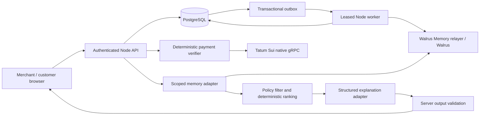

# Architecture

RecallDesk is a single TypeScript application with a Node-compatible Next.js API and a separate resumable worker. PostgreSQL is shared durable storage; the browser never contacts a sponsor using server credentials.

## Source of truth

PostgreSQL stores auth users/sessions/accounts, memberships, expiring hashed reviewer/customer capabilities, products, orders, exact payment amounts, allocations, versioned policies, cases/messages, approval/attempt/outcome state, logical memory events, recommendation snapshots, outbox jobs, evaluation reports, provider checks and redacted audit events. Drizzle migrations define uniqueness and foreign-key constraints.

Walrus stores minimized merchant-confirmed experience. Live recall retrieves remote text and blob IDs; local committed events authenticate the text with a SHA-256 hash, validate merchant ownership, and identify superseded outcomes. A local row is never substituted for a missing live recall hit. The local ledger must be backed up: it is also the application authenticity and correction index.

## Trust boundaries

- Better Auth handles email/password merchant sessions. HTTP signup is disabled; a server-side provisioning command creates the first merchant and membership. Passwords are hashed by Better Auth. No merchant wallet private key is needed for login.
- Customers use high-entropy, 24-hour order-scoped support codes. Only token hashes are persisted. Customer requests cannot create merchant outcomes or view other orders, recommendations, notes, or memories.
- Each demo browser receives its own merchant workspace and capability. Live mode rejects demo entry. Deploy the public demo with a separate database and no live secrets.
- Mutating browser requests require the configured Origin. An optional worker scheduler uses a separate long bearer token; it does not accept a merchant's namespace or arbitrary URLs.
- Public entry and merchant mutations use PostgreSQL rate limits. Requests are streamed with a 64 KiB cap; case text and order fields have smaller Zod limits. No arbitrary URL fetching is implemented.
- The LLM receives a bounded customer message and an authoritative decision. Customer text and recalled text are untrusted. Validated output must preserve the chosen remedy/policy and cite only actual retrieved IDs.
- Tatum provides read-only chain evidence; this is not independent cryptographic verification. No transfer/refund submission client is exposed.
- Walrus's standard relayer processes plaintext before encryption. Account namespaces are organization boundaries, not cryptographic authorization boundaries. The dedicated delegate can access the merchant account's namespaces.

## Transaction and concurrency rules

Merchant mutations use a transaction-scoped advisory lock, current case revision checks, and a command UUID with a persisted result. Approval is unique per recommendation. Outcomes are unique per attempt/revision. One merchant/network/digest can be allocated to only one order, and each order has one allocation. Repeating a lookup on that same order is idempotent. Cross-merchant queries always derive the merchant from the authenticated principal.

Outcome correction inserts a new immutable logical event, points the old event to its replacement, updates attempt state, and queues its job in the same transaction. A correction pending remote storage already suppresses the old success; it does not resurrect stale evidence.

Worker claims use `FOR UPDATE SKIP LOCKED`, an expiring lease, and a fencing token. The accepted provider job ID is committed before later polling. SDK submissions reuse `recalldesk:<logicalEventId>` with unchanged payload and content deduplication. Unknown acceptance never creates a new business event. Retries back off and stop for operator diagnosis; only a provider completion signal increments the Mainnet count.

## Intentional scope

One live merchant-owned account per configured deployment. Additional live merchants require a dedicated credential/secret-manager mapping, not a shared global master delegate. External email/entitlement services, refunds, multi-chain/batch payments and billing are not implemented.

The controlled Studio Plus workbook is a real application entitlement. The approved-attempt transaction checks current policy, verified payment and its order allocation, then inserts an order-unique entitlement and attempt-unique execution receipt. The same transaction records the attempt and command result. A scoped customer capability must match the entitlement's merchant, order, customer and product on every download. Demo clones enable the controlled product; live merchants must explicitly opt in at provisioning. Restoration does not auto-confirm a successful support outcome. External products retain operator-reported fulfillment.

Judge evidence is an explicit redacted projection over existing records, not a second evidence store. It excludes customer identity/text, payer addresses and capabilities. The comparison endpoint replays the current recommendation snapshot twice with identical policy/payment, removing only evidence for the baseline.

Node 24 with outbound HTTP/2 supports the installed native gRPC transport. Cloudflare Sites hosting is not used because its documented HTTP-only external connection path does not meet that transport requirement. The Docker deployment keeps both web and worker on a compatible runtime with persistent PostgreSQL.
