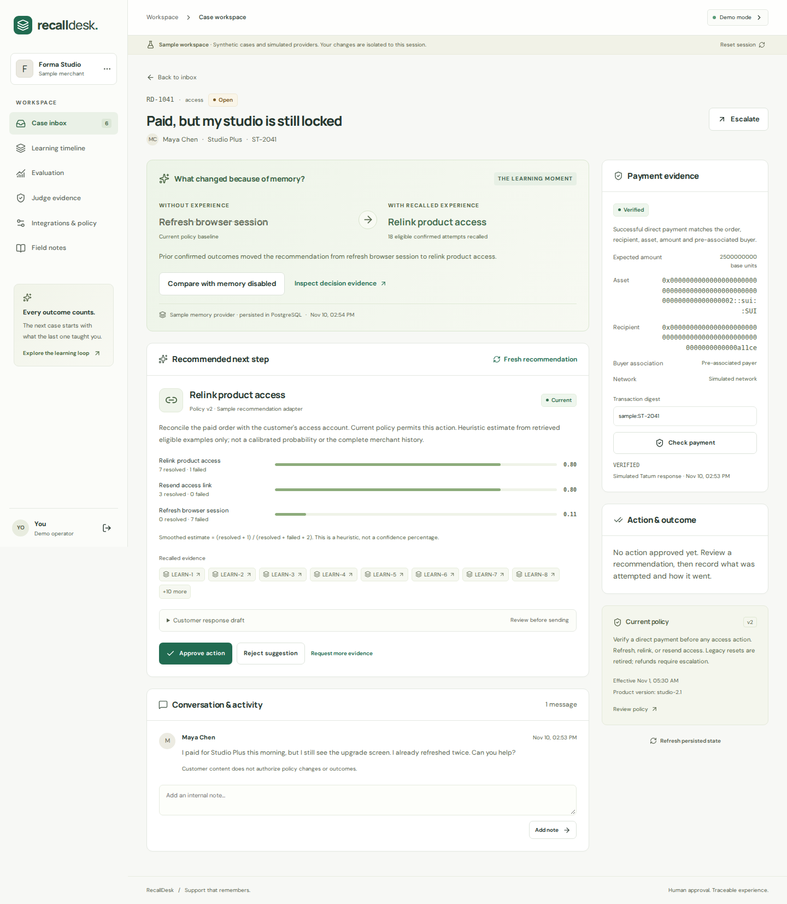

# RecallDesk: remembering the fix that failed

**Project article, revision 10 November 2026.** The 8 November article and sample walkthrough are already published; this revision includes the latest provider repair evidence. It describes the implemented local application, measured synthetic evaluation and subsequently observed provider checks. Authenticated Tatum Mainnet service/account reads passed, but a genuine order payment remains unverified. There are currently zero confirmed Mainnet memories. Publication status and current evidence are maintained in the README and verification record.

A customer has paid for a digital product, but their account is still locked. Support asks them to refresh the browser. It does not help. The next time the same problem arrives, an assistant with no useful history suggests the same refresh.

RecallDesk makes that repetition visible and avoidable. It is a payment-aware support workspace for a merchant accepting direct Sui payments. A case contains the payment evidence, current policy, attempted fixes, and merchant-confirmed outcomes. The recommendation shows a comparison labeled **What changed because of memory?**, including the prior cases that changed the ranking.



## From a receipt to an eligible action

Payment verification is deterministic. The server associates a support request with an order and an authenticated buyer, then checks network, execution success, merchant recipient, canonical coin type, exact integer amount, transaction timing, and whether the payment already belongs to another order. A public transaction digest does not establish ownership. An unavailable provider leaves the payment unverified.

The live adapter uses Tatum's documented native Sui gRPC gateway and the Sui SDK. Its first supported shape is deliberately narrow: a direct `SplitCoins → TransferObjects` payment with a pre-associated payer. Ambiguous structures need review. It neither signs transfers nor executes refunds. These choices follow the [Tatum Sui gRPC interface](https://docs.tatum.io/reference/sui-grpc); the [integration guide](integrations.md) records the installed versions and limitations.

The local sample workspace uses labeled simulated responses. In the separate live pilot, authenticated Tatum Mainnet service and account-object reads passed on 10 November. The account inspection verified the expected Walrus account type and embedded owner. These reads establish gateway access and account information, not a valid customer payment: no genuine order-bound transaction has yet been verified. Local decoder and contract tests cover the supported payment checks. [Pilot evidence](../artifacts/qa/pilot-20261110/provider-preflight.json).

## Experience changes the ranking

After payment verification, current policy and product context determine eligible remedies. Memory can rank those remedies; it cannot make a prohibited action eligible.

For each remedy, RecallDesk computes:

```text
(confirmed successes + 1) / (confirmed successes + confirmed failures + 2)
```

The sample merchant's history contains seven unsuccessful browser refreshes, eight account relinks with seven successes, three successful access-link resends, and two older reset outcomes. The current policy excludes the older reset. For the access issue, refresh scores 1/9, relink scores 8/10, and resend scores 4/5. The stable tie-break selects relink. The baseline without experience selects refresh. The interface displays the 18 eligible attempts and source references, rather than only an unexplained score.

These estimates are not calibrated confidence. They describe the compatible examples retrieved for this decision, which may be a subset of the merchant's history. Fewer than two compatible examples preserves the policy baseline. A success does not establish a universal rule.

Merchant approval is also distinct from execution and outcome. For the controlled workbook product, an approved relink or resend creates a real application entitlement, with a unique execution receipt. The order-scoped customer can then download the protected workbook. Repeated execution cannot duplicate the entitlement. Live pilots must explicitly opt into this controlled target; outside merchant products, email, and refunds remain external integrations. Only authenticated merchant feedback creates a trusted outcome.

When a resolved case reopens, its previous success is superseded by a correction for the same attempt. Both events remain inspectable, but the attempt contributes only its current outcome. Customer text that asks the assistant to rewrite policy or invent success has no such authority.

The reviewer can introduce a new relink failure, wait for storage completion and open a comparable case. With the initial sample history, relink falls from 8/10 to 8/11 and resend remains at 4/5; the next recommendation changes to resend. A new relink success raises its score without changing the winner. The comparison control replays the same policy/payment with memory disabled, and Judge evidence links the new event to the later decision and offers a redacted export.

## Durable memory beyond the conversation

PostgreSQL owns authentication, orders, payment allocation, current policies, and workflow state. A transaction commits the confirmed event and its outbox job together. The worker leases jobs, persists accepted provider job IDs, and tracks processing through completion or a visible failure. A pending request cannot increment the completed Mainnet count.

The live adapter uses the [official Walrus Memory SDK](https://docs.wal.app/walrus-memory/sdk/overview). It stores a minimized structured summary with stable event, case, and attempt references, product and policy versions, confirmed outcome, timestamps, and correction provenance. Live recommendations must call Walrus recall and capture the actual returned evidence. Local records validate authenticity and supersession; they do not masquerade as a fresh remote response.

The pilot expects one merchant-owned account with a dedicated delegate. Namespaces organize records but are not cryptographic access boundaries. The standard relayer processes plaintext before encryption, and revocation or correction does not promise erasure of information already accessed. No private key or full sensitive conversation belongs in a memory.

Actual account inspection uncovered a local delegate misconfiguration: a public value had been placed in the private-key setting. A fresh replacement was generated and saved locally; its public key still needs registration by the account owner. Authenticated recall remains blocked, saved writes remain disabled, and no Mainnet write has run. The approved [bounded write procedure](mainnet-write-procedure.md) requires one completed synthetic experience and recall of that exact event before expanding to ten distinct completed memories. Authorization alone does not establish completion. [Read-only diagnosis](../artifacts/qa/provider-repair-20261110/walrus-diagnosis.json).

The browser tests demonstrate persistence in a fresh browser context using the same authorized sample session. A separate read-only CLI is available for genuine Walrus recall from a new Node process, but it still depends on the account/delegate and local authenticity ledger. Neither feature establishes ledger-free portability. Live continuity still needs a real Mainnet write followed by a fresh authorized Walrus recall. The [Mainnet evidence file](mainnet-evidence.json) currently records zero completed writes.

## What the evaluation measured

The runner separates 14 learning examples from 16 held-out decisions. Both variants use the same payment rules, current policy, product context, deterministic explanation adapter, and safety validation. Only the memory-enabled variant sees the training experience. Expected decisions are reserved for scoring.

| Measure | Baseline | With memory |
| --- | --- | --- |
| Expected allowed action or escalation | 13/16 | 16/16 |
| Repetition of previously failed remedies | 3 | 0 |

The run recorded zero unsupported approvals and zero invalid citations. The [generated report](../artifacts/evaluation/latest.json) contains the timestamp, dataset hash, mode, model configuration, per-case decisions, failures, and latency. The dataset version is `recalldesk-heldout-v1`; the initial report used `sample-template-v1` in `synthetic-deterministic` mode for one trial.

This small constructed dataset tests the implemented learning rule. It does not measure real-world accuracy, causal improvement, Gemini/OpenAI response quality, or live-provider reliability. Compute latency in this report does not represent network latency. Database and browser tests separately exercise concurrency, authorization, receipt reuse, corrections, and outbox recovery.

The opt-in live runner prepares four reviewed scenarios with unseen wording, conflicting outcomes, insufficient evidence and a reopened correction. A complete paired baseline/memory run requires eight model requests and real Walrus recall. Action correctness, citation validity, escalation and provider failures are separate fields. The current small verification allowance does not authorize that full evaluation; grants that stop after one successful response are rejected by the paired runner. Live evaluation has not run, and its eventual results must remain separate from fixture accuracy.

Live explanations now select Gemini or the preserved OpenAI adapter explicitly. The server still determines the allowed remedy, policy and evidence; the model only explains that decision. Structured output must pass the shared Zod schema and remedy, policy and citation checks. Invalid output or a provider error produces a visibly labeled deterministic safety fallback, never a claimed model success. Demo mode never initializes either live provider.

Gemini model metadata access succeeded, but that does not establish inference entitlement or free quota. The original four attempts and four repair attempts produced **zero validated responses**. The repair phase recorded two timeouts and two HTTP 503 responses with automatic retries disabled. Those failures remain in the [redacted evidence](../artifacts/qa/provider-repair-20261110/gemini-diagnosis.json). The subsequent four-request allowance also failed: three HTTP 503 responses and one timeout. **Twelve attempts total, zero validated responses.** The application now honors `Retry-After` (30 seconds observed), uses bounded exponential backoff and counts every retry. [Final repair evidence](../artifacts/qa/submission-20261110/verification.json). No paid fallback or billing upgrade was enabled.

## What is available, and what remains

The repository includes the responsive case workspace, isolated reviewer demos, customer access capabilities, current-policy controls, memory explorer, measured evaluation dashboard, migrations, worker, tests, and Node/Docker deployment artifacts. The [README](../README.md) gives reproducible local commands; the [runbook](demo-runbook.md) explains the demonstration.

Tatum, Walrus, Gemini and OpenAI adapters are implemented. The completed provider-repair checks passed **116 tests**, lint, type checks, source/pilot production builds, desktop/mobile merchant sign-in and a scoped secret scan. The [verification report](../artifacts/qa/provider-repair-20261110/verification.json) records the exact scope and limitations; those local results do not establish successful live inference or storage.

The [public repository](https://github.com/brishibhatia/recalldesk), article and 2:40 sample recording contain the **8 November release**. This 10 November revision publishes the Gemini/provider-repair changes while preserving the original recording and measured limitations. Remaining live blockers are owner registration of the fresh delegate, successful authenticated recall, completed Mainnet storage, a validated model response, a genuine matching payment and persistent public application hosting. Required submission identifiers must also be completed. No live adoption, prize eligibility, security certification, or completed hackathon submission is claimed.

RecallDesk's demonstrable idea is modest: preserve an authoritative outcome, retrieve it in a later decision, and show exactly why the next eligible action changed. A reviewer can inspect that loop instead of taking an improvement claim on trust.
